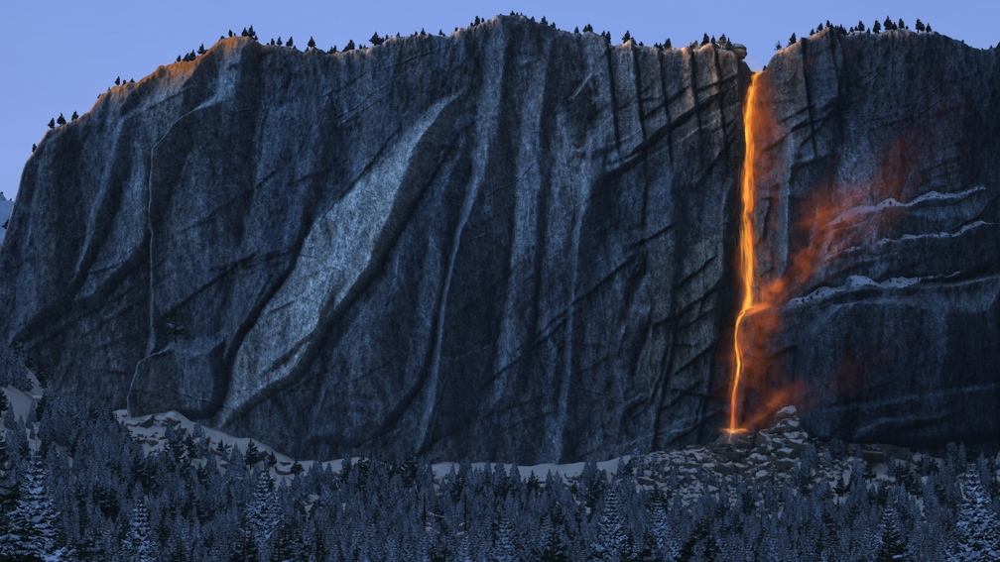

# Horsetail Firefall

In Yosemite, a narrow ribbon of water catches the last light after the surrounding granite falls into shadow. This 40-second Three.js film follows that light from the snowy pines to the brink, the impact rock and the river below. All seven shots move through one procedural 3D valley.

[](https://github.com/Leonxlnx/horsetail-firefall/releases/tag/v1.0.0)

**[Download the film · 1080p MP4](https://github.com/Leonxlnx/horsetail-firefall/releases/download/v1.0.0/Firefall-procedural.mp4)** · 40 seconds · 24 fps · Stereo

## Run the scene

With Node.js 20 or newer and a WebGL 2 browser, run these commands from the repository root.

```sh
npm ci
npm start
```

Open **http://localhost:4187**. Drag to move the camera, press Space to play or pause, or use 1–7 to jump to a shot. The arrow keys seek, M toggles sound and F enters fullscreen.

The live scene generates its own geometry, materials and chapter thumbnails. To enable offline film downloads and video fallback on devices without WebGL 2, place the release MP4 in `public/media/Firefall-procedural.mp4`.

## Inside the scene

- **Granite.** Profiles through the 1.4 km wall define its main fracture planes. The renderer bakes smaller cracks, mineral grain, weathering and sky exposure at startup.
- **Water.** A gravity-timed curtain breaks over two ledges. A volumetric pass scatters light through the mist, while thin sheets and individual droplets rise from the wet impact rock.
- **Forest and river.** Seeded branches carry needles and snow. Distant trees use an atlas generated from eight tree specimens. Moving water reflects a second camera view of the valley.

The camera and scene are in [horsetail.js](src/horsetail.js). The shot sequence is in [timeline.js](src/timeline.js).

## Render the film

With the server running, open a second terminal and run `npm run render`. The renderer needs Chrome or Edge, FFmpeg with libx264, and FFprobe. Set `CHROME_PATH` if the browser is installed in a custom location.

The renderer produces 960 frames with two shutter samples per frame, then muxes the soundtrack into `public/media/Firefall-procedural.mp4`. Completed shots are cached between runs. On Windows it samples CPU, GPU and available memory to pace the capture.

## License and music

The project source code is available under the [MIT License](LICENSE).

“Passage of Time” by Scott Buckley is licensed under CC BY 4.0. The film uses an edited excerpt mixed with synthesized waterfall and wind. When uploading the film to YouTube, include the music credit in the video description. [Original recording](https://www.scottbuckley.com.au/library/passage-of-time/) · [Music license](https://creativecommons.org/licenses/by/4.0/)
